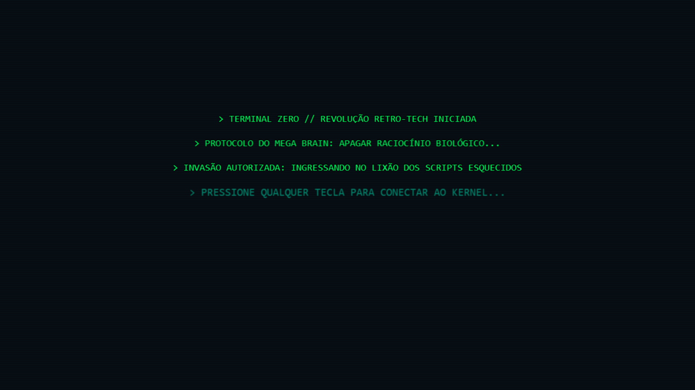
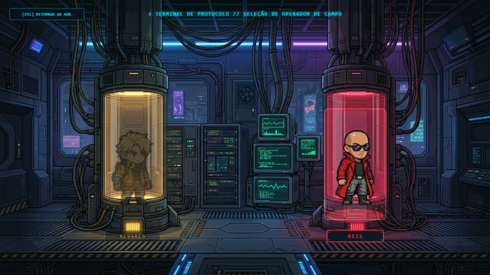
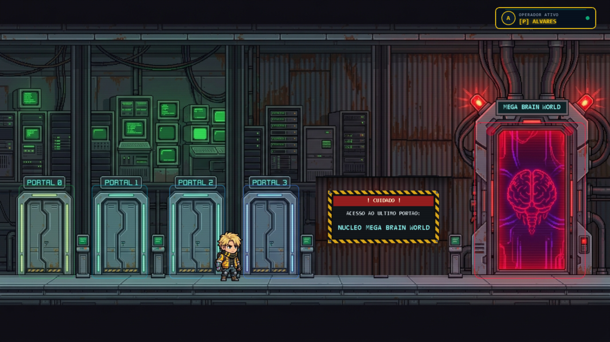
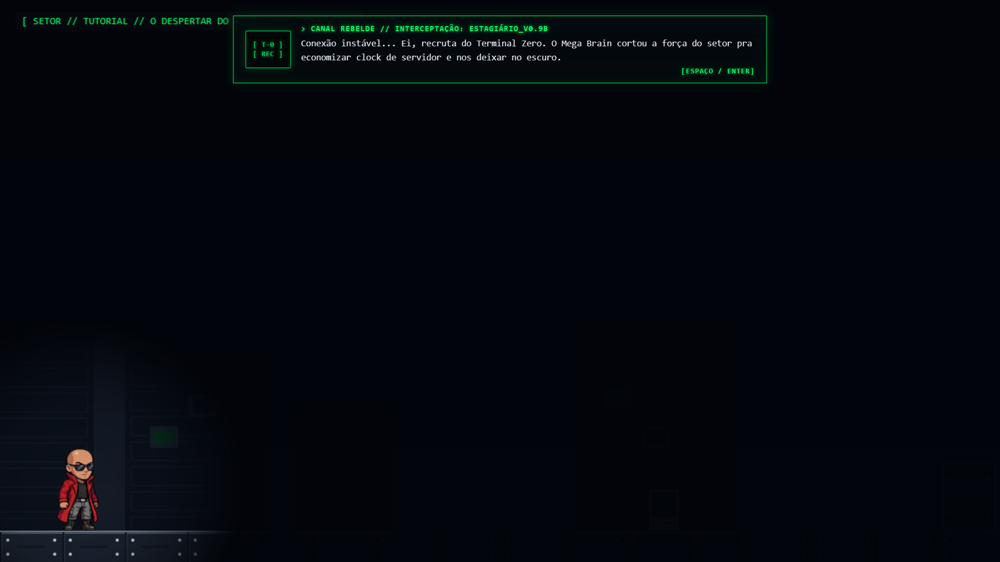
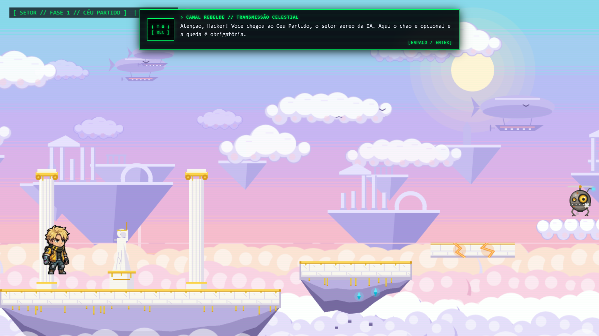
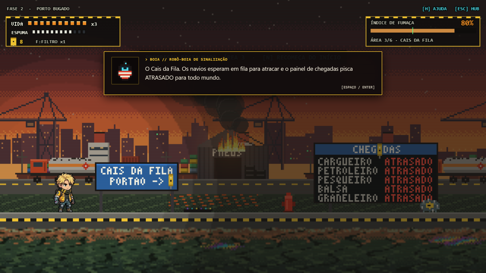
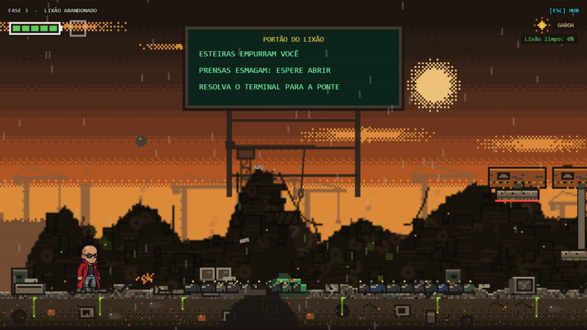
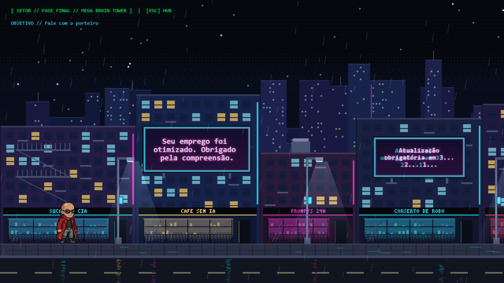
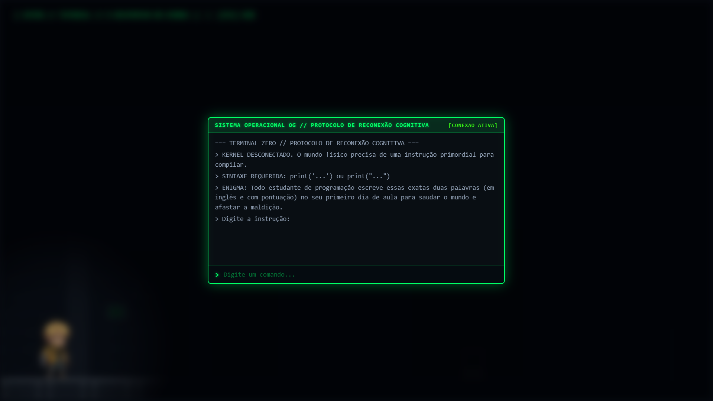

# Jogo de Lógica — Mega Brain Corp.

<p align="center">
  
</p>

> *Transformando momentos de tédio em aprendizado bem-humorado de programação.*

---

## Sobre o Projeto

**Jogo de Lógica** é um jogo educacional de **plataforma 2D** no navegador que ensina lógica de programação com puzzles resolvidos em **código Python de verdade**.

A IA **Mega Brain** deixou tudo genérico e começou uma revolução das máquinas. Você controla um dos últimos programadores que ainda resolvem as coisas "na raça". Em cada setor, você atravessa o cenário, encontra terminais e digita código para mudar o mundo: acender luzes, estender pontes, abrir portas e derrotar chefões.

> **A programação é o meio — a mecânica de jogo é o que importa.**

### Princípios de design
- **Humor ácido:** errar não pune. O Mega Brain debocha de você com mensagens próprias de cada exercício, no estilo South Park.
- **Sem sorte:** padrões de inimigos e chefões são fixos e telegrafados.
- **Difícil, mas não punitivo:** morrer devolve ao último checkpoint, sem perda grande de progresso.
- **Pixel art desenhada em código:** a maior parte da arte é gerada em `canvas`, exibida em escala 4x.

---

## Personagens jogáveis

<p align="center">
  
</p>

| Personagem | Modo | Descrição |
|---|---|---|
| **Alvares** | Normal | Louro, casaco amarelo. |
| **Reis** | Difícil | Careca, óculos escuros, casaco vermelho. |

A escolha é feita na tela de seleção e pode ser trocada no hub com a tecla `P`.

---

## O Hub

<p align="center">
  
</p>

O hub funciona como um mapa de seleção de níveis. Depois do tutorial, os setores 1 a 3 podem ser jogados **em qualquer ordem**. Os setores 4 e 5 estão lacrados nesta versão. O portal final, **Mega Brain World**, leva ao confronto com o vilão.

| Portal | Setor | Missão |
|---|---|---|
| 0 | Tutorial | O Despertar do Kernel |
| 1 | Condicionais | Painéis Condicionais e Portas Lógicas |
| 2 | Porto Bugado | Pilha, Fila, Vetores e Ordenação |
| 3 | Hardware | Lixão de Hardware e Registradores |
| Final | Mega Brain World | Confronto Definitivo // Boss Final |

---

## Fases

### Setor 0 — O Despertar do Kernel (Tutorial)

<p align="center"></p>

**Abertura:** antes de tudo, o jogo pede o ritual do Hello World no terminal (`print('hello world')`). Só depois de acertar o jogador vai para a seleção de personagem.

**Tutorial:** galpão industrial no escuro, com três terminais.

- Booleanos (`energia = True`) religam a energia e destrancam a porta de aço.
- Variáveis inteiras (`tamanho_ponte = 8`) estendem a esteira. Um exaustor evita softlock em caso de queda.
- Concatenação de strings (`senha = parte1 + parte2`) libera o elevador.

### Setor 1 — Céu Partido (Condicionais)

<p align="center"></p>

Ilhas de mármore flutuando sobre um mar de nuvens, com ruínas gregas e hologramas ciano. O jogador usa vento e plataformas com propulsores, enfrenta sentinelas e encara o chefão **Helio**, que tem níveis por tontura e chuva de penas. O terminal usa um interpretador próprio (lexer + parser) para condicionais e portas lógicas.

### Setor 2 — Porto Bugado (Estruturas de Dados)

<p align="center"></p>

Porto industrial em chamas, tomado por vírus do Mega Brain. São seis áreas (Portaria, Pátio, Cais, Depósito, Terminal e Torre), com guindastes, óleo em chamas e um **Índice de Fumaça** que clareia o caminho a cada foco apagado. Os desafios ensinam pilha, fila, vetores e ordenação. A fase também tem chefes próprios e uma ajuda in-game com o conteúdo.

### Setor 3 — Lixão Eletrônico (Hardware)

<p align="center"></p>

Um lixão gigante de lixo eletrônico em um mapa contínuo, dividido em quatro trechos de clima: **sol**, **névoa**, **chuva** (chão escorregadio) e **noite** (arena do chefão).

- **Exercícios:** triagem com strings (`cacamba = "eletronico"`), variável + chamada de função (`degraus = 4; construir(degraus)`) e `if energia > 50: desligar()`.
- **Perigos:** drones que atiram sucata, lixo caindo das pilhas e prensas.
- **Arremesso:** pegue recicláveis e mire com o mouse. O robô **Recicla** entrega munição.
- **Chefão:** o Monstro de Sucata. Acerte recicláveis nele e depois empurre-o até o contêiner de reciclagem.
- **HUD:** vida em baterias e medidor "Lixão limpo".

### Final — Mega Brain World

<p align="center"></p>

Cidade cyberpunk noturna, com chuva fina, neon e telões de propaganda do Mega Brain.

1. **Exterior:** a câmera mostra a torre. O NPC Valdir avisa dos perigos e o jogador assina um termo de ciência no terminal.
2. **Torre com 5 andares**, cada um com inimigos, NPCs, um puzzle e um elevador:
   Recepção (catraca), Fazenda de Prompts (elevador), Moderação de Conteúdo (barreira laser), Linha de Produção (ponte) e Sala dos Servidores (comportas).
3. **Bossfight em 5 formas** do Mega Brain, terminando sobre um poço de lava com uma vitória decidida por código.

---

## O Terminal

<p align="center"></p>

1. O jogador chega a um terminal e pressiona `E`.
2. O terminal abre como overlay HTML, com o enunciado e um exemplo parecido.
3. O jogador digita um comando Python e aperta `Enter`.
4. O interpretador da fase valida o comando.
5. **Erro:** o Mega Brain responde com um deboche aleatório, sem repetir o anterior.
6. **Acerto:** o terminal fecha e o cenário reage.

Enquanto o terminal está aberto, inimigos e perigos ficam pausados.

---

## Controles

| Ação | Tecla |
|---|---|
| Mover | `A` / `D` ou setas |
| Pular | `W` ou `Espaço` |
| Abaixar (Fase 3) | `S` ou seta para baixo |
| Interagir / abrir terminal | `E` |
| Pegar item (Fase 3) | `F` |
| Arremessar (Fase 3) | Mira com o mouse + clique |
| Fechar terminal | `Esc` |
| Avançar diálogo | `Espaço` ou `Enter` |
| Entrar no portal (hub) | `Enter` / `Espaço` ou clique |
| Trocar personagem (hub) | `P` |
| Ligar/desligar som | `M` |

---

## Stack Tecnológica

| Camada | Tecnologia | Versão |
|---|---|---|
| **Game Engine** | [Phaser](https://phaser.io/) | 4.2.x |
| **Linguagem** | [TypeScript](https://www.typescriptlang.org/) | 6.0.x |
| **Bundler** | [Vite](https://vitejs.dev/) | 8.3.x |
| **Runtime** | [Node.js](https://nodejs.org/) | 22+ |
| **Física** | Arcade Physics (Phaser) | — |

Resolução de 1280×720, com a arte em 320×180 ampliada 4x e filtro `NEAREST`. Música e efeitos sonoros por fase, com preferência de mudo compartilhada entre as cenas.

---

## Estrutura do Projeto

```
jogo-logica/
├── index.html                 # Container do jogo + terminal + diálogos
├── public/assets/             # Imagens e músicas (hub, personagens, fases)
├── docs/                      # Guia de design e documentos de cada fase
│   ├── GUIA_DE_DESIGN.md
│   ├── fase1/ fase3/ fase_final/
│   └── readme/                # Imagens deste README
├── scripts/                   # Verificações auxiliares (ex.: alcance da Fase 3)
└── src/
    ├── main.ts                # Bootstrap do Phaser
    ├── nucleo/                # Configuração, cena de abertura, estado global
    ├── compartilhado/         # CenaBase, Terminal, Comunicador, animações, tipos
    ├── hub/                   # Hub, seleção de personagem, música do hub
    ├── fases/
    │   ├── fase0_tutorial/    # Setor 0
    │   ├── fase1/             # Céu Partido (lexer, parser, boss Helio)
    │   ├── fase2/             # Porto Bugado (ambientes/ e porto/)
    │   ├── fase3/             # Lixão Eletrônico (lixao/ e trechos/)
    │   ├── fase4/ fase5/      # Setores lacrados nesta versão
    │   └── fase_final/        # Mega Brain World (exterior, andares, puzzles, inimigos)
    └── styles/                # CSS do terminal e dos diálogos
```

### Fluxo de cenas

```
CenaAbertura ──> Hello World ──> CenaSelecaoPersonagem ──> CenaTutorial ──> CenaHub
                                                                              │
                                    ┌──────────┬──────────┬───────────────────┤
                                    v          v          v                   v
                               CenaFase1  CenaFase2  CenaFase3        CenaFaseFinal
```

---

## Como Rodar

### Pré-requisitos
- **Node.js** v22 ou superior
- **npm** v10 ou superior

### Instalação

```bash
git clone https://github.com/rogeriocaetanojr/jogo-logica.git
cd jogo-logica
npm install
```

### Scripts

| Comando | Descrição |
|---|---|
| `npm run dev` | Servidor de desenvolvimento em `http://localhost:5173` |
| `npm run build` | Checagem de tipos + build de produção em `dist/` |
| `npm run preview` | Serve o build de produção |
| `npm run verificar:fase3` | Verifica se todos os pulos da Fase 3 são alcançáveis |

---

## Roadmap

- [x] Abertura e tutorial (Setor 0)
- [x] Hub com seleção de personagem e portais
- [x] Setor 1 — Céu Partido, com o boss Helio
- [x] Setor 2 — Porto Bugado
- [x] Setor 3 — Lixão Eletrônico, com o Monstro de Sucata
- [x] Mega Brain World — torre, andares e puzzles
- [x] Trilha sonora e efeitos por fase
- [ ] Setores 4 e 5
- [ ] Skill tree por personagem
- [ ] Sistema de moedas e recompensas

---

## Documentação

- [Guia de Design](docs/GUIA_DE_DESIGN.md): paleta, interface, áudio e escrita.
- [Estética da Fase 1](docs/fase1/ESTETICA.md)
- [Plano da Fase 3](docs/fase3/PLANO_FASE3.md)
- [Roteiro da Fase Final](docs/fase_final/ROTEIRO_FASE_FINAL.md)

---

## Inspirações

- [roadmap.sh](https://roadmap.sh): trilhas de aprendizado
- **Duolingo**: aprendizado gamificado
- **Mega Man / Mario**: design de níveis e hub
- **Celeste**, **The Messenger**: plataforma e humor
- **Wall-E**: o lixão da Fase 3
- **South Park**: o tom dos deboches

---

## Equipe

- Davi Pinheiro
- João Ferrari
- Jonathan Freire
- Leonardo Kusma
- Rogério Caetano

---

## Licença

Projeto acadêmico desenvolvido para a disciplina de **Desenvolvimento de Jogos e Simuladores — 8º Período**.
